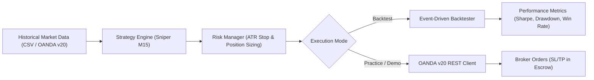

# Quantum Forex Trader (v2.0)

[](https://www.python.org/downloads/)
[](https://opensource.org/licenses/MIT)
[](https://github.com/psf/black)

A modular, high-performance algorithmic trading and quantitative backtesting framework engineered for foreign exchange markets. Designed with a dual-execution pipeline supporting both **event-driven historical backtesting** and **OANDA v20 REST API practice execution**.

---

## 🏛️ System Architecture



### Core Components
1. **`core/strategy_hybrid.py`**: Sniper M15 algorithmic trend continuation engine combining Exponential Moving Average ribbons (EMA 9, 21, 50, 200), Relative Strength Index (RSI), and dynamic Average True Range (ATR) expansion filters.
2. **`core/risk_manager.py`**: Mathematical capital preservation model calculating fractional risk per trade, volatility-based ATR stop loss distances, and an automated daily drawdown circuit breaker.
3. **`core/backtester.py`**: Event-driven backtesting simulator computing net return, win rate, profit factor, and maximum equity drawdown across historical candlestick datasets.
4. **`core/oanda_client.py`**: Resilient REST client interfacing with OANDA v20 endpoints with automatic mock fallbacks for offline testing.

---

## 🚀 Quick Start

### 1. Installation
Clone the repository and install dependencies:
```bash
git clone https://github.com/centolaer-commits/quantum-forex-trader.git
cd quantum-forex-trader
pip install -r requirements.txt
```

### 2. Run Historical Backtest
Run an offline backtest across the provided EUR/USD M15 historical dataset:
```bash
python main.py --mode backtest --csv data/backtest_data_EUR_USD_M15.csv
```

### 3. Connect to OANDA Practice / Demo
1. Copy `.env.example` to `.env`:
   ```bash
   cp .env.example .env
   ```
2. Populate your OANDA Practice credentials in `.env`:
   ```env
   OANDA_ACCESS_TOKEN=your_practice_token
   OANDA_ACCOUNT_ID=your_account_id
   OANDA_ENVIRONMENT=practice
   ```
3. Run live demo execution:
   ```bash
   python main.py --mode live-demo
   ```

---

## 🧪 Testing Suite

Execute the test suite with `pytest`:
```bash
pytest tests/ -v
```

---

## 🔒 Security & Best Practices
- **Zero Secrets Versioned**: API credentials, tokens, and private keys are strictly managed via environment variables and excluded via `.gitignore`.
- **Circuit Breaker Protected**: Automated trading halts if the account breaches the daily drawdown threshold (`MAX_DAILY_DRAWDOWN_PERCENT`).

---

## 📄 License
This project is licensed under the MIT License — see the LICENSE file for details.
